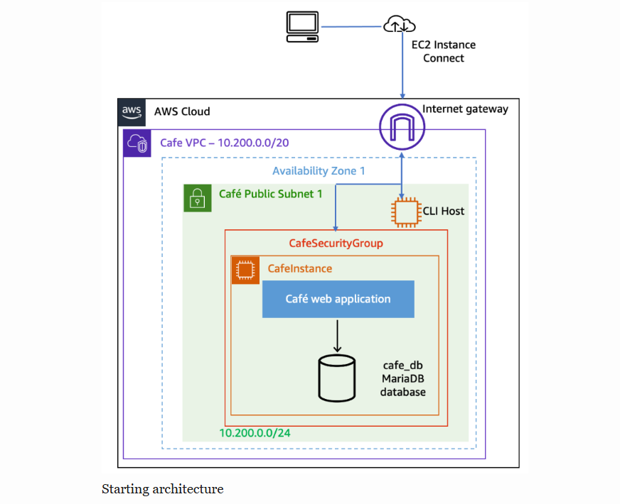

# Migrating a MariaDB Database from EC2 to Amazon RDS (AWS CLI)

A hands-on project (completed in an AWS Academy lab environment) where I moved the database of a café web application from a self-managed MariaDB server on EC2 to a managed **Amazon RDS for MariaDB** instance, then monitored it with **Amazon CloudWatch**.

## Project Overview

The café web application originally ran its web server and its MariaDB database on the same EC2 instance. That design has a single point of failure and leaves patching, backups, and scaling to the operator.

In this project I:

- Provisioned networking and security prerequisites for RDS using the **AWS CLI**
- Created a private, managed **RDS MariaDB** instance
- Migrated live application data using `mysqldump` and `mysql`
- Re-pointed the application to the new database through **AWS Systems Manager Parameter Store**, with no code changes
- Verified data integrity and monitored the instance with **CloudWatch metrics**

## Architecture

### Before migration

The web app and `cafe_db` both live on `CafeInstance` in a public subnet.

<!-- Add your screenshot:  -->
>

### After migration

The database moves to `CafeDBInstance` (RDS) in a private subnet. Only the café instance can reach it, through a security group rule.

<!-- Add your screenshot:  -->
>

| Component | Details |
|---|---|
| VPC | `10.200.0.0/20` |
| Public subnet | `10.200.0.0/24` (café web app, CLI host) |
| Private subnet 1 | `10.200.2.0/23` (same AZ as the café instance, hosts RDS) |
| Private subnet 2 | `10.200.10.0/23` (different AZ, required for the DB subnet group) |
| DB subnet group | `CafeDB Subnet Group` (spans both private subnets) |
| Security group | `CafeDatabaseSG`, allows TCP 3306 only from `CafeSecurityGroup` |
| RDS instance | `CafeDBInstance`, MariaDB 10.11.11, `db.t3.micro`, 20 GB, not publicly accessible |

## Services and Tools Used

- Amazon RDS (MariaDB)
- Amazon EC2 and EC2 Instance Connect
- Amazon VPC (subnets, security groups, DB subnet groups)
- AWS Systems Manager Parameter Store
- Amazon CloudWatch
- AWS CLI
- `mysqldump` / `mysql` client


### 1. Baseline data

Placed several orders on the café website and recorded the number shown on the **Order History** page, to compare after the migration.

- Orders placed before migration: 1

### 2. Prerequisites with the AWS CLI

Connected to the CLI Host with EC2 Instance Connect and ran `aws configure`.

**Create the database security group and allow MySQL only from the café instance's security group:**

```bash
aws ec2 create-security-group \
  --group-name CafeDatabaseSG \
  --description "Security group for Cafe database" \
  --vpc-id <vpc-id>

aws ec2 authorize-security-group-ingress \
  --group-id <cafe-database-sg-id> \
  --protocol tcp --port 3306 \
  --source-group <cafe-security-group-id>
```

**Create two private subnets in different Availability Zones:**

```bash
aws ec2 create-subnet --vpc-id <vpc-id> \
  --cidr-block 10.200.2.0/23 --availability-zone <cafe-instance-az>

aws ec2 create-subnet --vpc-id <vpc-id> \
  --cidr-block 10.200.10.0/23 --availability-zone <different-az>
```

**Group them into a DB subnet group:**

```bash
aws rds create-db-subnet-group \
  --db-subnet-group-name "CafeDB Subnet Group" \
  --db-subnet-group-description "DB subnet group for Cafe" \
  --subnet-ids <private-subnet-1-id> <private-subnet-2-id>
```

### 3. Create the RDS instance

```bash
aws rds create-db-instance \
  --db-instance-identifier CafeDBInstance \
  --engine mariadb \
  --engine-version 10.11.14 \
  --db-instance-class db.t3.micro \
  --allocated-storage 20 \
  --availability-zone <cafe-instance-az> \
  --db-subnet-group-name "CafeDB Subnet Group" \
  --vpc-security-group-ids <cafe-database-sg-id> \
  --no-publicly-accessible \
  --master-username root \
  --master-user-password '<your-db-password>'
```

Polled the status until it reached `available`, then recorded the endpoint:

```bash
aws rds describe-db-instances \
  --db-instance-identifier CafeDBInstance \
  --query "DBInstances[*].[Endpoint.Address,AvailabilityZone,PreferredBackupWindow,BackupRetentionPeriod,DBInstanceStatus]"
```

### 4. Migrate the data

From the café instance:

```bash
# Back up the local database
mysqldump --user=root --password='<local-db-password>' \
  --databases cafe_db --add-drop-database > cafedb-backup.sql

# Download the RDS CA bundle (RDS requires TLS by default)
curl -o global-bundle.pem https://truststore.pki.rds.amazonaws.com/global/global-bundle.pem

# Restore into RDS
mysql --user=root --password='<your-db-password>' \
  --host=<rds-endpoint> \
  --ssl-ca=./global-bundle.pem \
  < cafedb-backup.sql
```

Verified the import:

```bash
mysql --user=root --password='<your-db-password>' \
  --host=<rds-endpoint> --ssl-ca=./global-bundle.pem cafe_db
```
```sql
select * from product;
```

### 5. Point the application at RDS

Updated the `/cafe/dbUrl` parameter in **Systems Manager Parameter Store** to the RDS endpoint. Because the application read its database location from configuration, no code changes or redeployment were needed.

### 6. Verify

- Orders shown in Order History after migration: 1
- Result: `<matches the baseline / does not match>`

### 7. Monitor with CloudWatch

In the RDS console's **Monitoring** tab I reviewed metrics including `CPUUtilization`, `DatabaseConnections`, `FreeStorageSpace`, `FreeableMemory`, `ReadIOPS`, and `WriteIOPS`. I opened a MySQL session from the café instance and watched `DatabaseConnections` rise to 1, then return to 0 after exiting.


