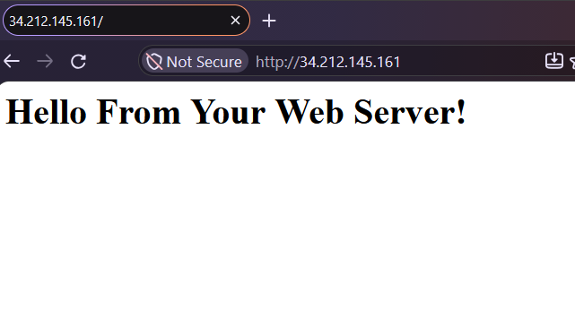
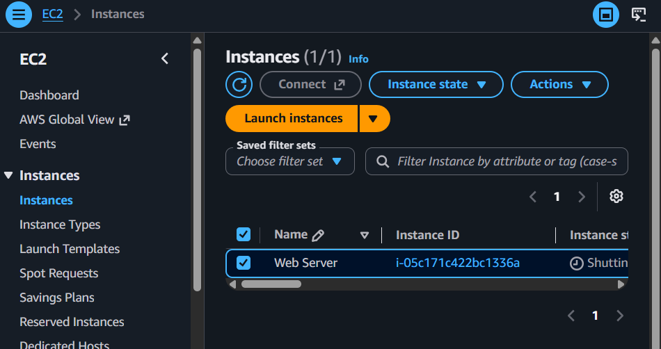

# Hosting a Web Server on Amazon EC2

A hands-on AWS project where I launched an Apache web server on an Amazon EC2 instance, bootstrapped it with a user data script, opened HTTP access through a security group, scaled the instance, and tested termination protection.



> **Note:** This was built in a temporary lab environment. The public IP shown in the screenshots (`34.212.145.161`) no longer resolves because the instance has been terminated.

---

## Table of Contents

1. [Objectives](#objectives)
2. [Architecture](#architecture)
3. [Services and Tools](#services-and-tools)
4. [Implementation Steps](#implementation-steps)
5. [Bootstrap Script](#bootstrap-script)
6. [Results](#results)
7. [Key Learnings](#key-learnings)
8. [Cost and Cleanup](#cost-and-cleanup)
9. [Next Steps](#next-steps)
10. [Author](#author)

---

## Objectives

- Launch a web server with termination protection enabled
- Monitor the EC2 instance
- Modify the security group to allow HTTP access
- Resize the EC2 instance to scale
- Test termination protection
- Terminate the EC2 instance

## Architecture

```
   Internet (HTTP :80)
          |
          v
 +-------------------+
 |  Security Group   |   Inbound: HTTP 80 from 0.0.0.0/0
 +---------+---------+
           |
           v
 +-------------------+
 |   EC2 Instance    |   Amazon Linux + Apache (httpd)
 |  (public subnet)  |   Termination protection: ON
 +-------------------+
```


| Component | Choice |
|---|---|
| AMI | Amazon Linux (Amazon Linux 2023*) |
| Instance type |  t3.micro initially, resized to t3.small |
| Network | Default VPC, public subnet, auto-assigned public IP |
| Storage |  8 GiB gp3 root volume |
| Security group | Inbound HTTP (80) added after launch |
| Key pair | Created for SSH access (private key not included in this repo) |

## Services and Tools

- **Amazon EC2**: compute
- **Amazon VPC and Security Groups**: network access control
- **Amazon CloudWatch**: instance monitoring
- **Apache HTTP Server**: web server software
- **Bash**: user data bootstrap script

## Implementation Steps

### 1. Launch the instance with the Launch Instance Wizard

Choices made in the wizard:

1. **AMI**: Amazon Linux
2. **Instance type**: t3.micro
3. **Network settings**: default VPC with a public IP
4. **IAM role**: none"
5. **User data**:

 #!/bin/bash
yum -y install httpd
systemctl enable httpd
systemctl start httpd
echo '<html><h1>Hello From Your Web Server!</h1></html>' > /var/www/html/index.html

6. **Storage options**:  8 GiB disk volume which was resized to 10GB
7. **Tags**: `Name = Web Server`
8. **Security group**: initially without HTTP access
9. **Key pair**: No  existing lab key pair since no SSH was been done in this la

Termination protection was enabled during launch under advanced details.



### 2. Monitor the instance

Checked the instance state, status checks and CloudWatch metrics (CPU utilization, network in/out) from the EC2 console.

### 3. Allow HTTP access

The web page would not load at first because the security group had no rule for port 80. I edited the inbound rules to add:

| Type | Protocol | Port | Source |
|---|---|---|---|
| HTTP | TCP | 80 | 0.0.0.0/0 |

After saving the rule, the page loaded in the browser.


### 4. Resize the instance

1. Stopped the instance
2. Changed the instance type under **Actions > Instance settings > Change instance type**
3. Started the instance again

Note that the public IP can change after a stop and start unless an Elastic IP is attached.


### 5. Test termination protection

Attempted to terminate the instance while protection was enabled. AWS blocked the action. I then disabled termination protection under **Actions > Instance settings > Change termination protection** and terminated the instance.


## Bootstrap Script

The script in [`user-data.sh`](user-data.sh) runs automatically on first boot, installs Apache and publishes a simple page:

```bash
#!/bin/bash
yum -y install httpd
systemctl enable httpd
systemctl start httpd
echo '<html><h1>Hello From Your Web Server!</h1></html>' > /var/www/html/index.html
```


## Results

Browsing to the instance's public IP over HTTP returned the page **"Hello From Your Web Server!"**, confirming that the bootstrap script, Apache, and the security group were all configured correctly.

## Key Learnings

- User data lets you configure a server automatically at launch, with no manual SSH setup.
- Security groups block all inbound traffic by default, so a missing port 80 rule is the first thing to check when a web server is unreachable.
- Instances must be stopped before changing their type, which means brief downtime and a possible public IP change.
- Termination protection is a simple safeguard against accidental deletion of important instances.
- Browsers flag plain HTTP as "Not Secure". A production setup would use HTTPS with a certificate.

## Cost and Cleanup

The instance was terminated at the end of the lab so that no further charges accrue. Always terminate unused resources and check for leftover volumes and Elastic IPs.


